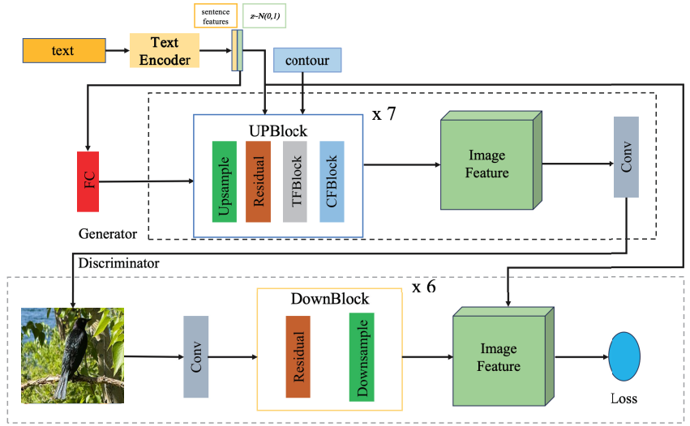

# CTFGAN: Contour-Text Fusion Generative Adversarial Network for Image Generation

CTFGAN is a single-stage GAN for contour-guided, text-conditioned image generation. TFBlock and CFBlock progressively fuse textual semantics and contour structures with multi-scale image features. A differentiable Sobel contour loss provides structural supervision. The model generates 256 × 256 images from a text description, a contour map, and random noise.



## Installation

Use Python 3.10+ and install a matching PyTorch/torchvision pair for your CUDA environment.

```bash
pip install -r requirements-ctfgan.txt
```

Run the following commands from the repository root.

## Datasets

We use the CUB-200-2011 and COCO 2014 datasets.

| Dataset | Images | Preprocessed metadata |
| --- | --- | --- |
| CUB-200-2011 | [Download](https://www.vision.caltech.edu/datasets/cub_200_2011/) | [Download](https://drive.google.com/file/d/1I6ybkR7L64K8hZOraEZDuHh0cCJw5OUj/view?usp=sharing) |
| COCO 2014 | [Download](https://cocodataset.org/#download) | [Download](https://drive.google.com/file/d/15Fw-gErCEArOFykW3YTnLKpRcPgI_3AB/view?usp=sharing) |

Place the data and matching pretrained DAMSM text encoders under:

```text
data/birds/
  CUB_200_2011/images/
  train/filenames.pickle
  test/filenames.pickle
  captions_DAMSM.pickle
  DAMSMencoder/text_encoder200.pth

data/coco/
  images/train2014/
  images/val2014/
  train/filenames.pickle
  test/filenames.pickle
  captions_DAMSM.pickle
  DAMSMencoder/text_encoder100.pth
```

## Training

First extract and save the paired Canny contour maps:

```bash
python code/ctfgan.py preprocess --cfg code/cfg/ctfgan_bird.yml
python code/ctfgan.py preprocess --cfg code/cfg/ctfgan_coco.yml
```

Then train the model:

```bash
# CUB
python code/ctfgan.py train --cfg code/cfg/ctfgan_bird.yml

# COCO
python code/ctfgan.py train --cfg code/cfg/ctfgan_coco.yml
```

Edit the corresponding YAML file to configure data paths, the DAMSM encoder, GPU, batch size, and output directory. Relative data and output paths are resolved from the repository root.

Default settings: Adam with learning rates `0.0001` (G) and `0.0004` (D), betas `(0.0, 0.9)`, batch size `32`, and contour loss weight `0.1`. Training runs for `1220` epochs on CUB and `290` epochs on COCO. Checkpoints are saved under `runs/ctfgan_bird/` or `runs/ctfgan_coco/`.

To resume training:

```bash
python code/ctfgan.py train --cfg code/cfg/ctfgan_bird.yml \
  --resume runs/ctfgan_bird/latest.pth
```

## Inference

Prepare a JSONL file named `pairs.jsonl`, with one text–contour pair per line:

```json
{"text":"this bird has a red head and black wings","contour":"data/birds/contours_256/test/class/image.png"}
```

Replace the contour path with an existing black-background, white-edge contour map. Relative contour paths are resolved from the JSONL file's directory. Both text and contour inputs are required.

```bash
# CUB
python code/ctfgan.py sample --cfg code/cfg/ctfgan_bird.yml \
  --checkpoint runs/ctfgan_bird/latest.pth \
  --manifest pairs.jsonl --count 4 --seed 42

# COCO
python code/ctfgan.py sample --cfg code/cfg/ctfgan_coco.yml \
  --checkpoint runs/ctfgan_coco/latest.pth \
  --manifest pairs.jsonl --count 4 --seed 42
```

Each input pair produces four images, saved in the corresponding `runs/ctfgan_*/samples/` directory.

## Evaluation

Evaluation code used in the paper:

- **IS:** [StackGAN Inception Model](https://github.com/hanzhanggit/StackGAN-inception-model)
- **FID:** [DM-GAN FID Evaluation](https://github.com/MinfengZhu/DM-GAN/tree/master/eval/FID)
- **LPIPS:** [Perceptual Similarity](https://github.com/richzhang/PerceptualSimilarity)
